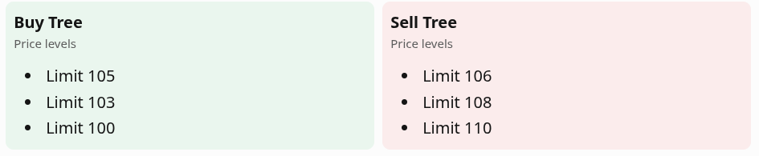
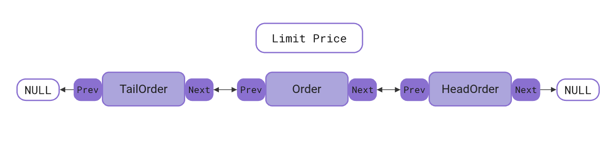

# Functional Limit Orderbook Engine For Discrete Event Simulator
---
    
## The following repository implements a `Limit Orderbook` that handles both Sell and Buy orders.

To run and see through the tests:
`g++ -std=c++17 -Wall -Wextra -Werror ./main.cpp ./matching_engine/matching_engine.cpp ./orderbook/orderbook.cpp ./trade_logger/trade_logger.cpp ./market_data/market_data_player.cpp ./market_data/market_data_parser.cpp -o ./orderbook.out`

---

### Journal [October 2026 Week 3 - November 2026 Week 1]

 
    
 The first few weeks of building this component for the thesis was mainly spent on understading the structure by trial & error and a lot of breaking things. It took some time to understand how each of the mechanims interact and what is the appropriate `Binary Search Tree` variant to be used for such an implementation. The available resource reference that I initially followed was using `AVL Tree` where it balances the `Binary Search Tree` via `branch rotation` and its `balance factor`. It was fairly complex to implement and it lead me to a roadblock. I finally settled on using `Red-Black Tree` for implementing this component.
 
 
    
### Journal [November 2026 Week 2 - November 2026 Week 3]

 
    
 The other hurdle that I experienced implementing this crucial component was the approach that I was taking. I mainly focused on avoiding memory handling since `Segfaults` are too time consuming to debug due to it not telling the programmer any useful error messages to trace where the memory leak happened. I tried using only `C++ STL Containers` and didn't bother building my own custom structs to guarantee memory safety. The biggest lesson that I learned from such approach is that; strict memory saftey comes with a larger trade-off and that is complexity. The codebase become incredibly difficult to work with because everything is filled with `std::unordered_map<int, std::list<std::unordered_map<std::string, int>>>` and I do write that by hand. The earlier approaches before that was using `C++ macros` which proven to be just as difficult to deal with. I finally settled with building it using custom structs and careful memory handling. I faced `Segfaults` from time to time but its a much more pleasurable codebase to work on.

## The implementation includes the following:
Implemented functionality:
- Limit order submission
- Market order submission
- Order cancellation
- Order modification
- Best bid and best ask retrieval
- FIFO order priority
- Price priority
- Partial order fills
- Full order fills
- Empty price-level removal
- Order lookup

 

Now that this component has been built. It can finally be run on top of an initialized simulation. The `trade logging` component and hte `market data` component will mostly handle the *Discrete Event* tracking and generation from an ingested market data.

## References
[Limit-Order-Book Project](https://github.com/brprojects/Limit-Order-Book)

[How To Build A Fast Limit Order Book](https://web.archive.org/web/20110219163448/http://howtohft.wordpress.com/2011/02/15/how-to-build-a-fast-limit-order-book/)
